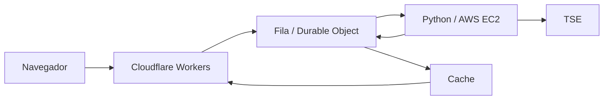

[Site do portfólio](https://davi-nr.github.io/davi-nr/) · [Notas dos projetos](PROJECTS.md) · [Estudo de segurança](01-controle-de-acesso-e-assinatura.md)

Sou **Davi Costa**, engenheiro de IA e desenvolvedor de software. Estou programando o **Ounce em Python**. A inferência fica na AWS e as ferramentas rodam no Mac. O runtime mantém a conversa, valida as chamadas de ferramentas e devolve os resultados ao modelo.

## Ounce

O agente tem histórico por projeto, respostas por streaming e ferramentas de arquivos, comandos e diagnóstico de rede.

- `list_files` e `read_file`: leitura limitada ao workspace, com validação dos caminhos e links simbólicos.
- `write_file` e `run_command`: escrita e execução com aprovação do usuário.
- `security_check`: adaptadores de HTTP, DNS, TLS e Nmap.
- Histórico: cada chamada de ferramenta fica junto do resultado, inclusive quando o contexto é reduzido.
- Execução: timeout, interrupção do grupo de processos e bloqueio de novas ações na rodada depois de uma recusa.

As etapas foram escrever o cliente de conversa, tratar o streaming, organizar o histórico, ligar as ferramentas e integrar a inferência na EC2. Depois, adicionei testes locais para recusa de ações, limites de arquivos, links simbólicos e retorno dos resultados.

Um problema do runtime é reduzir o histórico sem perder a relação entre chamada e resposta da ferramenta. Outro é interromper um comando e os processos que ele abriu. Essas regras estão no código Python do agente.

## 32Business Desk · 32Enterprises

Programei os módulos de clientes, agenda, produtos, estoque, vendas e caixa. A aplicação usa **JavaScript, Cloudflare Workers e D1**. As rotas validam a sessão e a organização antes de acessar os registros.

A imagem é da **reformulação em andamento**. Os números da captura são dados de demonstração, identificados na própria tela.

## Outros projetos

| Projeto | Implementação |
| --- | --- |
| **Chameleon** | Aplicativo macOS em **Objective-C, AppKit e WebKit**. Inspeção de Fetch, XHR, WebSocket e console, exportação de logs JSON e uma fixture que fornece vídeo à página em testes. |
| **Apuração.win** | Interface em **JavaScript**, API em **Workers** e coletor **Python** na AWS São Paulo para ler os arquivos oficiais do TSE. |
| **Souza Joias** | Loja com catálogo, produtos, estoque, sacola, painel autenticado e orçamento por WhatsApp. **JavaScript, Node.js, SQLite, Cloudflare e D1**. |
| **Auréa Joias** | Vitrine e painel para editar preço, composição, imagens, estoque e visibilidade. **JavaScript, Node.js, SQLite e D1**. |
| **DopZero** | Contas, quests, personagens, guildas e mensagens. **TypeScript, React, Vinext, Drizzle e D1**, com permissões por conta e associação à guilda. |
| **Auditoria HTTP** | Script **Python** para uma URL, com análise de headers e cookies e relatórios Markdown/JSON. |
| **Vídeos com código** | Composições em **JavaScript e TypeScript**, usando **HyperFrames e Remotion**, com narração, elementos e tempo controlados pela timeline. |

As lojas preparam sacola e orçamento; não têm pagamento integrado. O Chameleon usa uma fixture na página, sem instalar uma câmera no sistema.

## API e coletor do Apuração.win

O navegador chama o Worker. Um Durable Object coordena a fila e evita trabalhos duplicados. O coletor Python na EC2 consulta o TSE e devolve o arquivo para o cache compartilhado.

Usei o EA14 para identificar UFs com avanço e o EA20 para ler os votos. A API valida eleição, turno e abrangência, respeita `Retry-After` e preserva o último resultado válido em falhas. A atualização depende da fonte e do coletor ligado.

## Linguagens que usei

| Linguagem | Nos projetos |
| --- | --- |
| **Python** | Ounce, coletor do TSE e scripts de diagnóstico. |
| **JavaScript** | Business Desk, Apuração.win, lojas e rotas no Cloudflare Workers. |
| **TypeScript** | DopZero, React/Vinext, esquema Drizzle e composições de vídeo. |
| **Objective-C** | Chameleon, com AppKit e WebKit no macOS. |
| **SQL** | Tabelas, consultas e migrações em SQLite e Cloudflare D1. |
| **HTML e CSS** | Interfaces, responsividade, componentes e apresentações. |
| **Shell** | Scripts de build, inicialização e atalhos no macOS. |

Desenvolvo no **macOS**, com terminal e Git. Na **AWS**, usei EC2, Linux, túneis e Systems Manager. No **Cloudflare**, publiquei Workers e configurei D1, KV, Static Assets e Durable Objects. Uso Playwright para conferir as interfaces.

## Estudos e materiais

- [Análise de controle de acesso e assinatura em uma API](01-controle-de-acesso-e-assinatura.md).
- [Documentário em vídeo](videos/vizinho-publico-documentario.mp4).
- [Servidor MCP para produção de vídeos](mcp/vizinho-publico-producer/README.md).
