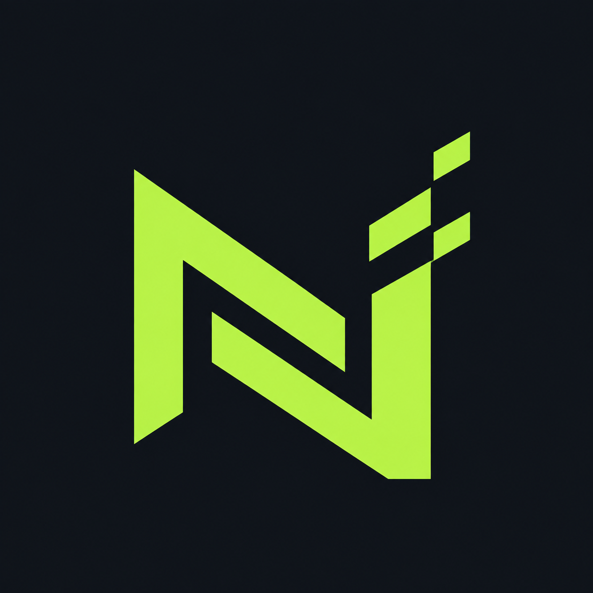

  

# Davi · NORASTREABILITY TEAM

Pesquisa em segurança de aplicações web e APIs, com foco em autenticação, controle de acesso e lógica de negócio.

Este perfil reúne meus estudos, laboratórios e análises técnicas. Os textos apresentam os procedimentos realizados, as evidências e os limites de cada resultado.

## Estudos de caso

### [Controle de acesso e validação de assinatura em uma aplicação web](01-controle-de-acesso-e-assinatura.md)

Análise de respostas de API, exposição de campos internos, provisionamento de contas e comportamento de uma barreira de assinatura diante de uma resposta alterada no cliente.

O estudo diferencia a liberação da interface da autorização de operações no servidor e registra os pontos que ainda precisam de validação.

## Áreas de interesse

- Autenticação, sessões e autorização.
- Isolamento de dados entre usuários e contas.
- Exposição de informações em APIs.
- Validação de regras de negócio no servidor.

Os exemplos públicos são anonimizados. Reconstruções visuais são identificadas como simulações e não substituem evidências originais.

## Documentário histórico

### Afinal, a esquerda governou o Brasil por mais tempo que a direita?

[Assistir ou baixar o vídeo (MP4, 1080 × 1920)](videos/vizinho-publico-documentario.mp4)
