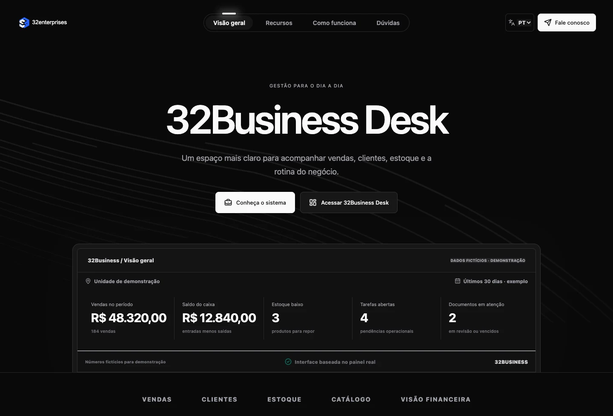
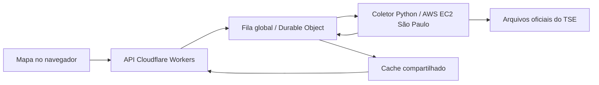

<a href="https://davi-nr.github.io/davi-nr/"><strong>Explorar meu portfólio</strong></a> &nbsp; / &nbsp; <a href="PROJECTS.md">Detalhes dos projetos</a> &nbsp; / &nbsp; <a href="01-controle-de-acesso-e-assinatura.md">Estudo de segurança</a>

Sou **Davi Costa**, engenheiro de IA e desenvolvedor de software. Estou programando o **Ounce em Python**. Também desenvolvi sistemas web, APIs, um navegador de laboratório e e-commerces. Eu cuido do código, das integrações e do deploy.

Nos projetos abaixo, usei **JavaScript, TypeScript, Python, Objective-C, SQL, HTML, CSS e Shell**. Trabalhei com aplicações web, um aplicativo nativo para macOS, agentes de IA e infraestrutura na AWS e no Cloudflare.

Na **32Enterprises**, desenvolvo o **32Business Desk**. Também desenvolvi o agente **Ounce**, o navegador **Chameleon**, e-commerces e uma API com coletor na AWS para o **Apuração.win**.

## 32Business Desk · 32Enterprises

Sistema para centralizar clientes, agenda, catálogo, estoque, vendas e financeiro, com módulos por segmento e controle de acesso por organização.

**JavaScript · Python · Cloudflare Workers · D1 · SQLite · HTML · CSS**

Desenvolvimento de interfaces responsivas, rotas autenticadas, validação de dados e persistência no servidor. A imagem apresenta a **reformulação em andamento**, com indicadores demonstrativos identificados na própria interface.

## Projetos selecionados

| Projeto | O que desenvolvi | Tecnologias |
| --- | --- | --- |
| **Ounce AI** | Agente no terminal com streaming, contexto por projeto, ferramentas locais e aprovação de escritas/comandos; inferência na AWS e runtime próprio em Python. | Python, AWS EC2, streaming JSON, tool calling |
| **Chameleon** | Navegador nativo de laboratório com inspeção de requests/responses, console, WebSocket, exportação JSON e fixture de vídeo. | Objective-C, AppKit, WebKit, JavaScript |
| **Apuração.win** | Mapa eleitoral e API com fila global, cache e coletor Python na AWS São Paulo para consultar arquivos oficiais do TSE. | JavaScript, Python, Workers, Durable Objects, KV, EC2 |
| **Souza Joias** | E-commerce com catálogo persistente, painel de gestão, estoque, sacola e fluxo de orçamento via WhatsApp. | JavaScript, Node.js, SQLite, Cloudflare, D1 |
| **Auréa Joias** | Vitrine com identidade própria, gestão de catálogo, estoque, visibilidade e sessão administrativa protegida. | JavaScript, Node.js, SQLite, D1 |
| **DopZero** | Aplicação de desenvolvimento pessoal com quests, personagens, contas, guildas e comunidade. | TypeScript, React, Vinext, Drizzle, D1, Three.js |
| **Auditoria HTTP** | Triagem HTTP com referências CWE, evidências sanitizadas e relatórios Markdown/JSON. | Python, HTTP, TLS, JSON |
| **Produção visual programável** | Composições editáveis de vídeos, demonstrações de produto e materiais explicativos. | JavaScript, TypeScript, HyperFrames, Remotion, SVG |

[Ver escopo, arquitetura e decisões de cada projeto →](PROJECTS.md)

O **Ounce** tem runtime próprio em Python e integra inferência na AWS a ferramentas executadas localmente. O **Chameleon** utiliza uma fixture explícita no contexto da página para testes autorizados; não instala uma câmera física no sistema. Os e-commerces têm estágios próprios de integração comercial; sacola e orçamento não equivalem a pagamento confirmado.

## Engenharia de IA: Ounce

O Ounce é o agente que estou desenvolvendo em **Python**. Programei o runtime de conversa, o gerenciamento de contexto, a execução de ferramentas e a integração com inferência na AWS.

1. **Runtime e streaming:** leitura incremental das respostas, processamento de mensagens e ciclo de chamadas de ferramentas.
2. **Contexto e histórico:** sessões por projeto, orçamento de contexto e preservação dos pares chamada/resultado ao reduzir o histórico.
3. **Ferramentas e permissões:** leitura/escrita de arquivos, comandos e diagnósticos HTTP, DNS e TLS; validação de caminhos, bloqueio de arquivos sensíveis e aprovação antes de executar alterações.
4. **Infraestrutura:** inferência em AWS EC2, ferramentas no Mac e comunicação por túnel, mantendo essas duas partes separadas.
5. **Validação:** testes locais para recusa de ações, escopo de arquivos, links simbólicos, interrupção de processos e retorno dos resultados.

A parte técnica mais exigente é manter o estado consistente durante a execução. O runtime limita os ciclos de ferramentas, preserva a relação entre chamada e resultado, interrompe processos em timeout e bloqueia novas ações na rodada após uma recusa. Esses controles fazem parte do código do agente.

**Linguagem principal: Python.** Integrações: AWS EC2, streaming JSON e tool calling.

## API e coletor na AWS

No Apuração.win, desenvolvi uma API que coordena a consulta executada na AWS e distribui o resultado por cache:

O fluxo inclui deduplicação por arquivo, validação de eleição/turno/abrangência, timeout, retentativas graduais, tratamento de `429` e `Retry-After` e preservação do último resultado válido. A atualização depende da publicação da fonte e da disponibilidade operacional do coletor.

## Linguagens e tecnologias que usei

| Camada | Tecnologias |
| --- | --- |
| Linguagens | JavaScript, TypeScript, Python, Objective-C, SQL, HTML, CSS e Shell |
| Interfaces | React, Next.js/Vinext, Tailwind CSS, SVG, AppKit e WebKit |
| Backend e dados | Node.js, Python, REST, SQLite, Cloudflare D1, Drizzle, KV e Durable Objects |
| Infraestrutura | AWS EC2, AWS Systems Manager, Linux, Cloudflare Workers e Static Assets |
| IA e automação | Tool calling, streaming, gerenciamento de contexto, MCP, HyperFrames e Remotion |
| Desenvolvimento e diagnóstico | macOS, terminal, Git/GitHub, Playwright, Burp Suite, Nmap e protocolos HTTP/DNS/TLS |

## Segurança de aplicações

Pesquisa em autenticação, autorização, sessões, APIs e lógica de negócio em ambientes próprios, laboratoriais ou autorizados. Trabalho com reprodução de cenários, interpretação de respostas HTTP, revisão de código, evidências e limites de validação.

**[Controle de acesso e validação de assinatura em uma aplicação web](01-controle-de-acesso-e-assinatura.md)** — estudo que diferencia mudanças na interface da autorização de operações no servidor.

## Outros materiais

- [Documentário histórico em vídeo](videos/vizinho-publico-documentario.mp4).
- [Servidor MCP Vizinho Público](mcp/vizinho-publico-producer/README.md), para preparação de produções e integração de narração.

As capturas do Business Desk são da reformulação em andamento. O escopo e o estágio de cada projeto estão descritos em PROJECTS.md.
